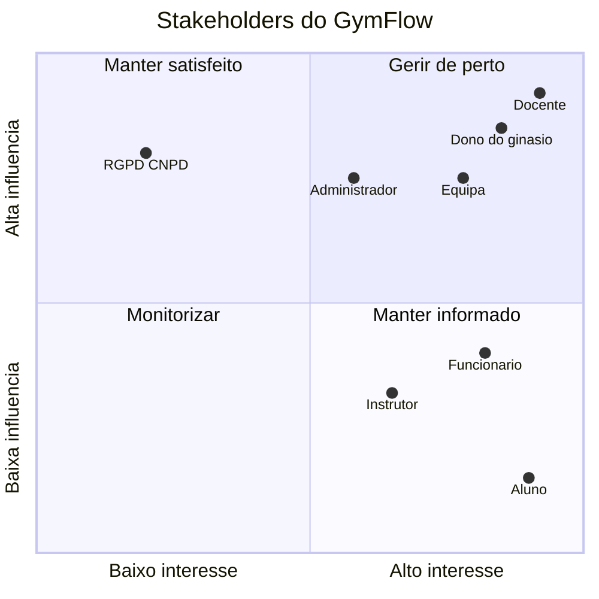
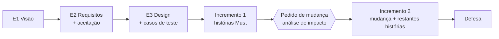

# GymFlow — E1: Visão e plano

**Projeto de Engenharia de Software Assistida por IA**

|             |                                                                                              |
| ----------- | -------------------------------------------------------------------------------------------- |
| Grupo       | GymFlow - Turma A PL                                                                         |
| Elementos   | Duarte Hilário Caramelo (2024061) Gabriel Stangarlin (2024219) Miguel Duarte (2024534) |
| Domínio     | Gestão de ginásio                                                                            |
| Repositório | [https://github.com/GabrielStangarlin/GymFlow](https://github.com/GabrielStangarlin/GymFlow) |
| Entrega     | E1 — 22/11/2026                                                                              |

---

## 1. Visão do sistema

### 1.1 Contexto

O GymFlow é um sistema de gestão para um ginásio com sala livre e aulas de grupo (cycling, pilates, funcional). Já existe um **protótipo exploratório**, feito com IA antes do enunciado, com inscrição de alunos, planos com janelas horárias, assinaturas e pagamentos manuais, entradas por QR code e dashboard. O projeto **evolui esse protótipo** para o centro do domínio, alterando o que existe:

| Hoje (protótipo)                                 | Passa a                                                                                     |
| ------------------------------------------------ | ------------------------------------------------------------------------------------------- |
| O plano define janelas horárias de entrada       | O plano define um **limite de aulas por semana** (ou ilimitado); as janelas deixam de existir |
| O QR regista entrada e saída                     | O QR regista entrada e saída e **marca presença** na sessão em que o aluno está inscrito     |
| Recusa por pagamento em falta ou fora do horário | Recusa por pagamento em falta, lotação máxima ou QR desconhecido                            |
| O aluno só vê o seu QR code                      | O aluno consulta aulas, inscreve-se, cancela, entra em lista de espera e aceita vagas        |
| Não há aulas nem instrutores                     | Aulas, sessões, inscrições, lista de espera e o papel de **instrutor**                      |

### 1.2 Problema

- As aulas têm lugares limitados e a recepção gere à mão quem entra e quem fica à espera: aulas sobrelotadas, lugares vazios por desistências não comunicadas e reclamações de quem estava "primeiro".
- Quando alguém desiste, o lugar não passa de forma justa e rápida ao seguinte da fila.
- Os planos são vendidos por número de aulas por semana, mas ninguém controla se o aluno faz mais aulas do que o plano permite.
- O instrutor não sabe antecipadamente quantas pessoas vêm, nem quem faltou.
- Alunos com pagamento em atraso continuam a reservar lugar.

### 1.3 Utilizadores

| Utilizador                | O que faz no sistema                                                                                |
| ------------------------- | --------------------------------------------------------------------------------------------------- |
| **Aluno**                 | Consulta o horário, inscreve-se, cancela, entra em lista de espera, aceita ofertas de vaga, mostra o QR. |
| **Instrutor**             | Consulta as suas sessões, os inscritos e as presenças.                                              |
| **Funcionário (receção)** | Inscreve alunos, gere assinaturas, pagamentos, aulas e sessões, lê o QR na entrada.                 |
| **Administrador**         | Tudo o que o funcionário faz, mais a gestão de contas de funcionários e instrutores.               |

### 1.4 Âmbito

1. **Aulas e sessões:** o funcionário define aulas (modalidade, instrutor, dia, hora, duração, lotação) e o sistema gera as sessões concretas.
2. **Inscrição em sessões** respeitando lotação, limite semanal do plano e estado da assinatura.
3. **Lista de espera** por ordem de chegada, com **oferta de vaga por email com prazo**; se não for aceite a tempo, passa ao seguinte.
4. **Planos com limite semanal**, em vez de janelas horárias.
5. **Entrada por QR com marcação de presença** e **área do instrutor**.
6. **Mantém-se do protótipo:** ativação de conta por email, assinaturas e pagamentos manuais, terminação automática por atraso, gestão de funcionários, registo de entradas, dashboard.

### 1.5 Fora do âmbito

Pagamentos online e faturação; aplicação móvel nativa (as áreas são web); vários ginásios; API pública; prorata em mudanças de plano; gestão de RH dos instrutores; notificações por SMS ou push (só email); redesenho visual do CRM.

---

## 2. Análise de stakeholders

| ID  | Stakeholder                           | Interesses                                                                        | Preocupações / conflitos                                                  | Influência | Interesse |
| --- | ------------------------------------- | --------------------------------------------------------------------------------- | ------------------------------------------------------------------------- | ---------- | --------- |
| S1  | **Dono do ginásio**                   | Aulas cheias sem passar da lotação; pagamentos a tempo; planos por nível           | Regras rígidas (ex.: prazo de oferta curto) que afastem clientes          | Alta       | Alto      |
| S2  | **Funcionário da receção**            | Deixar de gerir listas de espera à mão; leitura de QR rápida; menos discussões    | Casos que o sistema não cobre (aluno sem telemóvel, QR que não lê)        | Média      | Alto      |
| S3  | **Aluno**                             | Garantir lugar; saber a posição na fila; ser avisado quando há vaga               | Perder uma oferta por não ver o email a tempo; regras de limite pouco claras | Baixa   | Alto      |
| S4  | **Instrutor**                         | Saber quantos vêm e quem faltou; turma sem excesso de pessoas                     | Trabalho administrativo extra                                             | Média      | Alto      |
| S5  | **Administrador**                     | Controlar quem acede ao sistema                                                   | Contas de ex-funcionários ou ex-instrutores ativas                        | Alta       | Médio     |
| S6  | **Titulares dos dados / RGPD (CNPD)** | Dados pessoais (NIF, contactos, presenças) usados só para a finalidade e protegidos | Exposição de dados; histórico de presenças guardado sem limite          | Alta       | Baixo     |
| S7  | **Docente (avaliador)**               | Engenharia rastreável (requisitos → testes → código); uso de IA declarado         | Código sem testes; trabalho não defendido individualmente                 | Alta       | Alto      |
| S8  | **Equipa de projeto**                 | Entregar a tempo, com nota individual justa                                       | Carga desigual; dependência excessiva da IA                               | Alta       | Alto      |

**Conflitos a resolver nos requisitos (E2):** prazo da oferta de vaga (curto enche a aula, longo dá tempo ao aluno); faltas contarem ou não para o limite semanal (protege lugares vs. afasta alunos); o instrutor só deve ver os dados mínimos dos alunos das suas sessões (RGPD).

---

## 3. Registo de riscos

**Escalas:** Probabilidade (P) e Impacto (I) de 1 a 3. P: 1 pouco provável, 2 pode acontecer, 3 provável ou já aconteceu. I: 1 atraso de horas, 2 atraso de dias ou falha num caso de uso, 3 compromete uma entrega ou a defesa. **Exposição = P × I**; riscos com exposição ≥ 6 são revistos em todas as reuniões.

| ID  | Cat.       | Risco (causa → consequência)                                                                                                                                         | P   | I   | Exp. | Mitigação                                                                                                              | Resp.   |
| --- | ---------- | -------------------------------------------------------------------------------------------------------------------------------------------------------------------- | --- | --- | ---- | ---------------------------------------------------------------------------------------------------------------------- | ------- |
| R01 | **IA**     | Ao remover as janelas horárias, `AccessScanTest` e `PlanManagementTest` falham e a IA "corrige" os testes em vez do código → a verificação desaparece sem ninguém notar | 3   | 3   | 9    | Alterações em `tests/` só com justificação no PR; o revisor confirma que nenhum teste foi apagado fora da rastreabilidade | Gabriel |
| R02 | **IA**     | A IA implementa a lógica nova ao lado da antiga (mantém a recusa "fora do horário") → duas regras de acesso contraditórias                                            | 3   | 2   | 6    | O prompt diz o que remover; teste de regressão que falha se as janelas horárias ainda forem consultadas                  | Gabriel |
| R03 | **IA**     | Código gerado passa nos casos "felizes" mas falha nos limites: última vaga, oferta que expira no segundo exato, semana à meia-noite de segunda, mudança de hora em `Europe/Lisbon` | 3 | 3 | 9 | Casos de teste por partições de equivalência e valores-limite desenhados no E3, antes do código; datas fixas nos testes | Miguel  |
| R04 | **IA**     | A IA gera as rotas novas (área do instrutor, inscrições) sem verificação de papel → um aluno ou instrutor acede ao CRM                                                | 2   | 3   | 6    | Teste de autorização por papel para cada rota nova; o revisor confirma o middleware em cada PR                          | Miguel  |
| R05 | **IA**     | Requisitos propostos pela IA aceites sem revisão (ambíguos ou não verificáveis) → testes impossíveis de escrever                                                      | 2   | 3   | 6    | Cada requisito revisto por quem não o escreveu; registo dos requisitos rejeitados e porquê                               | Duarte  |
| R06 | **IA**     | Um elemento não consegue explicar na defesa código gerado pela IA                                                                                                    | 2   | 3   | 6    | Todo o código entra por PR revisto por outro elemento, que o tem de saber explicar; rotação de revisores                | Gabriel |
| R07 | **IA**     | Dados reais ou segredos em prompts ou no repositório (já aconteceu: uma palavra-passe local ficou num documento de design)                                            | 2   | 2   | 4    | Só dados fictícios; `.env` fora do Git; procurar palavras-passe nos ficheiros alterados antes de cada PR               | Miguel  |
| R08 | Técnico    | Dois alunos ocupam a última vaga ao mesmo tempo, ou uma oferta é aceite no instante em que expira → sessão sobrelotada                                                | 2   | 3   | 6    | Bloqueio de linha na transação (padrão já usado no protótipo); teste dedicado                                          | Duarte  |
| R09 | Técnico    | A expiração das ofertas depende do agendador (`schedule:work`); se parar, as vagas ficam presas em ofertas vencidas                                                    | 2   | 2   | 4    | Verificar também a expiração quando o aluno aceita; comando manual para processar ofertas vencidas                      | Miguel  |
| R10 | Técnico    | A câmara só funciona em `localhost`/HTTPS → a demonstração do QR falha na defesa                                                                                     | 2   | 3   | 6    | Ensaiar no equipamento da defesa; túnel HTTPS preparado; introdução manual do token como recurso                       | Gabriel |
| R11 | Equipa     | A maioria dos commits até ao E1 é de um só elemento → nota individual reduzida para os outros                                                                         | 3   | 3   | 9    | Cada elemento faz os seus commits; tarefas atribuídas por nome no backlog; PR obrigatório                               | Duarte  |
| R12 | Processo   | O protótipo foi feito antes dos requisitos e dos testes → partes do sistema sem rastreabilidade                                                                       | 3   | 2   | 6    | Casos de uso escolhidos na parte nova; a parte existente recebe requisitos e testes de regressão retroativos             | Gabriel |
| R13 | Calendário | O pedido de mudança chega a 13–14/1 e o sprint 2 tem ~11 dias, em época de avaliações de outras UC                                                                    | 3   | 2   | 6    | Matriz de rastreabilidade sempre atualizada para a análise de impacto; os itens Could do sprint 2 servem de folga       | Duarte  |

---

## 4. Modelo de processo

> Rascunho com base nos modelos dados até agora (Cascata, Incremental, Espiral); fecha depois da aula de Scrum, XP e RUP.

### 4.1 Contexto que condiciona a escolha

1. **Os testes têm de ser desenhados antes do código**, a partir dos requisitos.
2. **Calendário fixo:** E1 (22/11), E2 (27/11), E3 (18/12), sprint 1 (4/1 até à aula 11), pedido de mudança (13–14/1), sprint 2 (até 25/1), defesa (27–28/1).
3. **Pedido de mudança garantido** a meio da construção, a absorver sem partir o que funciona.
4. **O código é gerado por IA**, e a sua qualidade depende dos artefactos dados como contexto.
5. **Já existe um protótipo** a modificar, por isso os testes de regressão são essenciais.
6. **Equipa de três, a tempo parcial, sem cliente real**, que reúne sobretudo na aula semanal.

### 4.2 Modelo escolhido: Incremental, com especificação e testes desenhados antes do primeiro incremento

- **Especificação (E1 → E3), feita uma vez, no início:** requisitos e critérios de aceitação (E2), depois design e casos de teste (E3), antes de existir código novo.
- **Construção em dois incrementos (sprints 1 e 2):** cada incremento entrega casos de uso completos sobre o protótipo, que só contam como feitos quando passam os testes do E3.

**Porquê:**

- **Testes antes do código (1):** a especificação completa antes do primeiro incremento dá tempo para desenhar os casos de teste no E3, como o enunciado exige.
- **Absorve a mudança (3):** o incremento 2 começa pela análise de impacto sobre a matriz de rastreabilidade; o que o incremento 1 entregou fica protegido pelos testes.
- **Encaixa no calendário (2):** as três entregas de especificação e os dois sprints correspondem às fases e aos incrementos do modelo.
- **Evolui o protótipo (5):** cada incremento modifica o sistema existente; os testes de regressão correm em cada PR.
- **Contexto para a IA (4):** os requisitos e os casos de teste com valores-limite feitos antes do código são o que se dá à IA nos prompts, o que reduz os riscos R01–R04.

### 4.3 Alternativas rejeitadas

| Alternativa | Porque não serve neste contexto                                                                                                                                                                                            |
| ----------- | -------------------------------------------------------------------------------------------------------------------------------------------------------------------------------------------------------------------------- |
| Cascata     | Uma única entrega no fim: o pedido de mudança chega a 13–14/1 com código já feito (3) e obrigaria a voltar às fases anteriores; também não prevê a evolução de um sistema existente (5).                                  |
| Espiral     | Os riscos técnicos mais incertos (câmara no browser, filas de email, agendador) já foram eliminados pelo protótipo; os ciclos são fixados pelo calendário (2) e não pela análise de riscos; a análise formal em cada volta pesa numa equipa de três a tempo parcial (6). |

Da Espiral aproveita-se a revisão do registo de riscos no início de cada entrega e de cada sprint.

---

## 5. Product backlog inicial

**Priorização:** MoSCoW (Must, Should, Could, Won't); dentro de cada nível, primeiro o que tem mais risco (secção 3) e o que desbloqueia outras histórias. A tabela está ordenada por essa prioridade. **Estimativa** em pontos (1, 2, 3, 5, 8), relativa à US-04.

| #  | ID    | História                                                                                                                                         | Prior. | Pts | Sprint |
| -- | ----- | ------------------------------------------------------------------------------------------------------------------------------------------------ | ------ | --- | ------ |
| 1  | US-01 | Como **funcionário**, quero definir para cada plano um limite de aulas por semana (ou ilimitado), em vez de janelas horárias, para vender planos por número de aulas. | Must | 5 | 1 |
| 2  | US-02 | Como **funcionário**, quero criar uma aula com modalidade, instrutor, dia, hora, duração e lotação, para publicar o horário.                     | Must   | 3   | 1      |
| 3  | US-03 | Como **funcionário**, quero que o sistema gere as sessões das próximas semanas e poder cancelar uma sessão, para os alunos se inscreverem em datas reais. | Must | 5 | 1 |
| 4  | US-14 | Como **administrador**, quero criar e desativar contas de instrutor, para controlar quem acede à área do instrutor.                             | Must   | 2   | 1      |
| 5  | US-04 | Como **aluno**, quero ver as sessões da semana com os lugares livres, para escolher a que aula ir.                                               | Must   | 2   | 1      |
| 6  | US-05 | Como **aluno**, quero inscrever-me numa sessão com vaga, se o pagamento estiver em dia e não tiver atingido o limite semanal, para garantir o lugar. | Must | 5 | 1 |
| 7  | US-06 | Como **aluno**, quero entrar na lista de espera de uma sessão cheia e ver a minha posição, para ter hipótese de vaga.                           | Must   | 3   | 1      |
| 8  | US-07 | Como **aluno**, quero cancelar a minha inscrição numa sessão, para libertar o lugar.                                                            | Must   | 2   | 1      |
| 9  | US-08 | Como **aluno em lista de espera**, quero receber uma oferta de vaga por email, com prazo, quando alguém cancela, para não perder a vaga.          | Must   | 5   | 1      |
| 10 | US-10 | Como **aluno em lista de espera**, quero que uma oferta não aceite no prazo passe ao seguinte, para as vagas não ficarem presas.                  | Must   | 5   | 2      |
| 11 | US-09 | Como **aluno**, quero aceitar ou recusar uma oferta de vaga na minha área, para ficar inscrito ou dar a vez ao seguinte.                          | Must   | 3   | 2      |
| 12 | US-11 | Como **funcionário**, quero ler o QR do aluno e o sistema registar a entrada (ou recusá-la com o motivo) e marcar presença na sessão a decorrer.  | Must   | 5   | 2      |
| 13 | US-12 | Como **instrutor**, quero ver as minhas próximas sessões com inscritos e presenças, para preparar a aula.                                        | Should | 3   | 2      |
| 14 | US-13 | Como **instrutor**, quero marcar manualmente a presença de um inscrito, para os casos em que o QR não foi lido.                                  | Should | 2   | 2      |
| 15 | US-15 | Como **instrutor**, quero que os inscritos sem presença fiquem como "falta" no fim da sessão, para ter histórico de faltas.                     | Could  | 3   | 2      |
| 16 | US-23 | Como **funcionário**, quero inscrever ou cancelar um aluno numa sessão a partir do CRM, para ajudar quem não usa a área do aluno.               | Could  | 3   | 2      |
| 17 | US-22 | Como **dono do ginásio**, quero ver no dashboard a ocupação por aula e a taxa de faltas, para ajustar o horário.                                 | Could  | 5   | 2      |

**Existente no protótipo (Must/Should, a cobrir com testes de regressão, sem estimativa):** US-16 inscrever aluno com ativação de conta por email (Must) · US-17 marcar pagamentos e ver estado da assinatura (Must) · US-18 terminar assinaturas com mais de 2 dias em atraso (Must) · US-20 aluno vê o seu QR (Must) · US-19 gerir funcionários (Should) · US-21 consultar registo de entradas e recusas (Should).

**Won't (esta versão):** US-24 Como **funcionário**, quero tabelas com pesquisa e ações sem recarregar a página, para trabalhar mais depressa.
