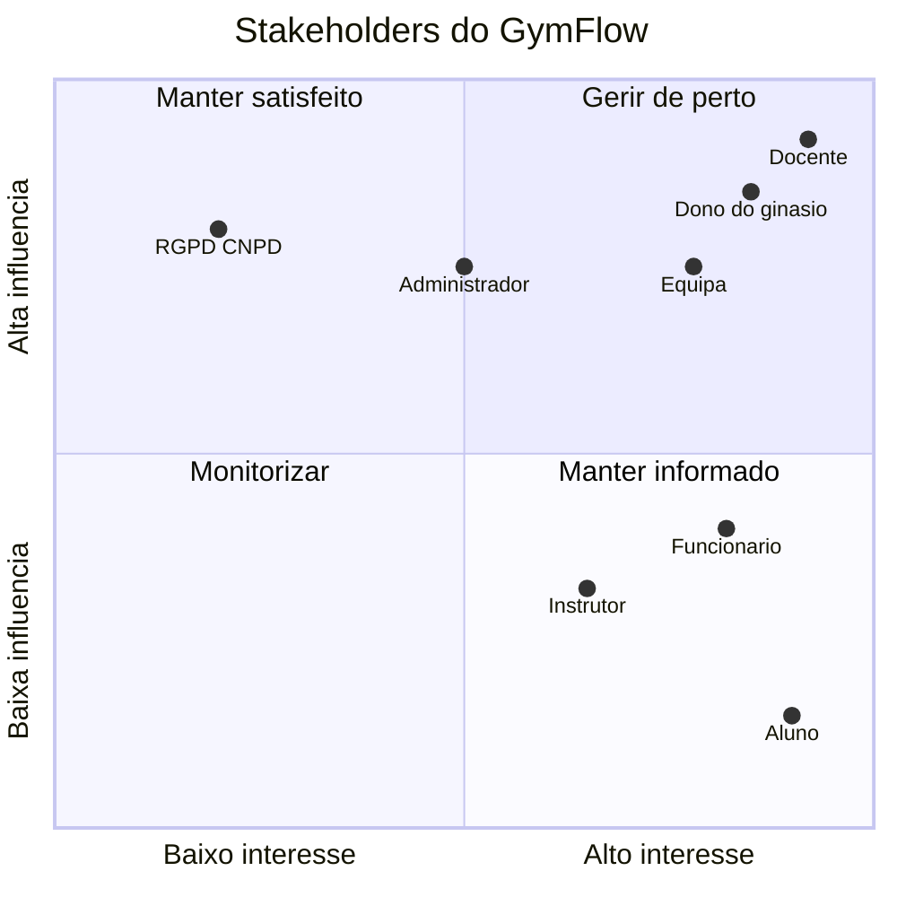
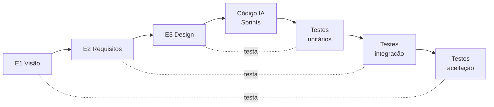

# GymFlow — E1: Visão e plano

**Projeto de Engenharia de Software Assistida por IA**

|             |                                                                                              |
| ----------- | -------------------------------------------------------------------------------------------- |
| Grupo       | GymFlow - Turma A PL                                                                         |
| Elementos   | Duarte Hilário Caramelo (2024061) Gabriel Stangarlin (2024219) Miguel Duarte (2024534) |
| Domínio     | Gestão de ginásio                                                                            |
| Repositório | [https://github.com/GabrielStangarlin/GymFlow](https://github.com/GabrielStangarlin/GymFlow) |
| Entrega     | E1 — 13/11/2026                                                                              |

### Histórico de revisões

| Versão | Data       | Autor                           | Alteração                                       |
| ------ | ---------- | ------------------------------- | ----------------------------------------------- |
| 0.1    | 09/11/2026 | Gerado com apoio de IA (Claude) | Rascunho inicial a partir das decisões do grupo |
| 1.0    | 09/11/2026 | Duarte, Gabriel e Miguel        | Revisão pelo grupo                              |

### Índice

1. Declaração de uso de IA e ponto de partida
2. Visão do sistema
3. Análise de stakeholders
4. Registo de riscos
5. Modelo de processo
6. Product backlog inicial

---

## 1. Declaração de uso de IA e ponto de partida

### 1.1 Ferramentas de IA

| Ferramenta                       | Gratuita para todos | Para quê                                                                                |
| -------------------------------- | ------------------- | --------------------------------------------------------------------------------------- |
| Claude / Claude Code (Anthropic) | Não                 | Design e código do protótipo inicial; rascunho deste documento, revisto pelo grupo      |
| ChatGPT (OpenAI), plano gratuito | Sim                 | Apoio à especificação, revisão de requisitos e geração de código por todos os elementos |

Todo o texto e código produzido pela IA é revisto por pelo menos um elemento do grupo antes de entrar no repositório. As interações relevantes ficam registadas no diário de engenharia (E4). Não são usados dados pessoais reais nem segredos nos prompts.

### 1.2 Ponto de partida: protótipo existente

Antes de o enunciado ser publicado, foi construído com IA um protótipo do GymFlow, que cobre a inscrição de alunos, planos com janelas horárias, assinaturas e pagamentos manuais, controlo de entradas e saídas por QR code e um dashboard. O grupo assume-o como **protótipo exploratório**: serviu para validar a stack e os pontos técnicos mais incertos (câmara no browser, filas de email, tarefas agendadas).

A partir desta entrega, todas as alterações seguem o processo descrito na secção 5: requisitos, depois testes, depois código, sempre por pull request revisto. Os casos de uso a implementar de ponta a ponta são escolhidos na parte nova do sistema (aulas), para que sigam o processo completo.

---

## 2. Visão do sistema

### 2.1 Contexto

O GymFlow é um sistema de gestão para um ginásio com sala livre e aulas de grupo (ex.: cycling, pilates, funcional). O projeto consiste em **evoluir o protótipo** para o centro do domínio: aulas com lotação, listas de espera com promoção automática e planos com limite de aulas por semana. Esta evolução **modifica** o que existe, não é um módulo acrescentado ao lado:

| Hoje (protótipo)                                                    | Passa a                                                                                                                                  |
| ------------------------------------------------------------------- | ---------------------------------------------------------------------------------------------------------------------------------------- |
| O plano define janelas horárias em que o aluno pode entrar          | O plano define um **limite de aulas por semana** (ou ilimitado); as janelas horárias deixam de existir                                   |
| O QR regista entrada e saída no ginásio                             | O QR continua a registar entrada e saída e, se o aluno estiver inscrito numa sessão a decorrer, **marca também a presença** nessa sessão |
| Entrada recusada por pagamento em falta ou fora do horário do plano | Entrada recusada só por pagamento em falta (pendente, em atraso, sem assinatura) ou QR desconhecido                                      |
| O aluno só vê o seu QR code                                         | O aluno consulta aulas, inscreve-se, cancela, entra em lista de espera e aceita ofertas de vaga                                          |
| Não existem aulas nem instrutores                                   | Aulas, sessões, inscrições, lista de espera e o papel de **instrutor** com acesso ao sistema                                             |

### 2.2 Problema

- As aulas têm lugares limitados. Hoje a receção gere à mão quem entra em cada aula e quem fica à espera, o que gera aulas sobrelotadas, lugares vazios por desistências não comunicadas e reclamações de quem estava "primeiro".
- Quando alguém desiste, não há forma justa e rápida de passar o lugar ao seguinte da fila.
- Os planos são vendidos por número de aulas por semana, mas ninguém controla se o aluno faz mais aulas do que o plano permite.
- O instrutor não sabe antecipadamente quantas pessoas vêm, nem quem faltou.
- Alunos com pagamento em atraso continuam a reservar lugar em aulas.

### 2.3 Utilizadores

| Utilizador                | O que faz no sistema                                                                                                                             |
| ------------------------- | ------------------------------------------------------------------------------------------------------------------------------------------------ |
| **Aluno**                 | Consulta o horário das aulas, inscreve-se, cancela, entra em lista de espera, aceita ou recusa ofertas de vaga e apresenta o QR code na receção. |
| **Instrutor**             | Consulta as suas sessões, a lista de inscritos e as presenças de cada sessão.                                                                    |
| **Funcionário (receção)** | Inscreve alunos no ginásio, gere assinaturas e pagamentos, gere aulas e sessões, lê o QR na entrada.                                             |
| **Administrador**         | Tudo o que o funcionário faz, mais a gestão de contas de funcionários e instrutores.                                                             |

### 2.4 Âmbito

1. **Aulas e sessões:** o funcionário define aulas (modalidade, instrutor, dia da semana, hora, duração, lotação) e o sistema gera as sessões concretas (aula X no dia Y).
2. **Inscrição em sessões pelo aluno**, respeitando a lotação da sessão, o limite semanal do plano e o estado da assinatura.
3. **Lista de espera:** se a sessão está cheia, o aluno entra numa fila ordenada por ordem de chegada.
4. **Promoção automática com oferta com prazo:** quando alguém cancela, o primeiro da fila recebe uma oferta de vaga por email, com um prazo para aceitar; se não aceitar a tempo, a oferta passa ao seguinte.
5. **Planos com limite semanal**, substituindo as janelas horárias.
6. **Entrada por QR com marcação de presença** na sessão em que o aluno está inscrito.
7. **Área do instrutor** com as suas sessões, inscritos e presenças.
8. **Mantém-se do protótipo:** inscrição de alunos com ativação de conta por email, assinaturas e pagamentos manuais, terminação automática de assinaturas em atraso, gestão de funcionários, registo de entradas e saídas, dashboard.

### 2.5 Fora do âmbito

- Pagamentos online (gateway), faturação e recibos.
- Aplicação móvel nativa (as áreas do aluno e do instrutor são páginas web).
- Vários ginásios.
- API pública.
- Cálculo proporcional (prorata) em mudanças de plano a meio do período.
- Gestão de recursos humanos dos instrutores (horários de trabalho, salários, substituições).
- Notificações por SMS ou push (só email).

### 2.6 Restrições

- Laravel 13 / PHP 8.4, Blade + Tailwind, MySQL, PHPUnit (stack do protótipo).
- Código gerado por ferramentas de IA; o grupo especifica, revê e testa.
- Apenas dados fictícios.
- A leitura do QR pela câmara só funciona em `localhost` ou HTTPS.
- Calendário fixo: sprint 1 de 4/1 até à aula 11, sprint 2 de 13–14/1 até 25/1/2027.

### 2.7 Critérios de sucesso

- Nenhuma sessão fica com mais inscritos do que a lotação.
- Nenhum aluno faz mais aulas por semana do que o plano permite.
- Uma vaga libertada é oferecida ao primeiro da fila sem intervenção da receção.
- Nenhum aluno com pagamento em falta entra no ginásio ou se inscreve numa aula.
- Os casos de uso escolhidos (secção 6.2) passam todos os testes desenhados pelo grupo.

---

## 3. Análise de stakeholders

### 3.1 Stakeholders e interesses

| ID  | Stakeholder                           | Interesses                                                                                                       | Preocupações / conflitos                                                      | Influência | Interesse | Envolvimento                                                                                        |
| --- | ------------------------------------- | ---------------------------------------------------------------------------------------------------------------- | ----------------------------------------------------------------------------- | ---------- | --------- | --------------------------------------------------------------------------------------------------- |
| S1  | **Dono do ginásio**                   | Aulas cheias sem passar da lotação; alunos a pagar a tempo; planos vendidos por nível (mais aulas = mais caro)   | Que regras rígidas (ex.: prazo de oferta curto) afastem clientes              | Alta       | Alto      | Valida as regras de negócio (limites, prazos, penalizações); representado pelo grupo e pelo docente |
| S2  | **Funcionário da receção**            | Deixar de gerir listas de espera à mão; leitura de QR rápida; menos discussões com alunos                        | Casos que o sistema não cobre (aluno sem telemóvel, QR que não lê)            | Média      | Alto      | Utilizador principal do CRM                                                                         |
| S3  | **Aluno**                             | Garantir lugar nas aulas; saber a posição na fila; ser avisado quando há vaga                                    | Perder uma oferta por não ver o email a tempo; regras de limite pouco claras  | Baixa      | Alto      | Utilizador da área do aluno                                                                         |
| S4  | **Instrutor**                         | Saber quantos alunos vêm; turma sem excesso de pessoas; saber quem faltou                                        | Ver dados de alunos que não são das suas aulas; trabalho administrativo extra | Média      | Alto      | Utilizador da área do instrutor                                                                     |
| S5  | **Administrador**                     | Controlar quem tem acesso ao sistema                                                                             | Contas de ex-funcionários ou ex-instrutores ativas                            | Alta       | Médio     | Gestão de contas                                                                                    |
| S6  | **Titulares dos dados / RGPD (CNPD)** | Dados pessoais (NIF, data de nascimento, email, telemóvel, presenças) tratados só para a finalidade e protegidos | Exposição de dados; histórico de presenças guardado sem limite                | Alta       | Baixo     | Requisitos não funcionais de privacidade; dados fictícios no projeto                                |
| S7  | **Docente (avaliador)**               | Engenharia rastreável (requisitos → design → testes → código); uso de IA declarado                               | Código sem testes; trabalho não defendido individualmente                     | Alta       | Alto      | Entregas E1–E4, checkpoint oral, defesa e pedido de mudança                                         |
| S8  | **Equipa de projeto**                 | Entregar a tempo, com nota individual justa                                                                      | Carga desigual; dependência excessiva da IA                                   | Alta       | Alto      | Especifica, revê, testa e responde por todo o sistema                                               |

### 3.2 Matriz influência × interesse

### 3.3 Conflitos de interesses a resolver nos requisitos (E2)

- **Dono vs. aluno — prazo da oferta de vaga:** um prazo curto enche a aula mais depressa; um prazo longo dá tempo ao aluno para ver o email.
- **Dono vs. aluno — faltas:** contar as faltas no limite semanal protege os lugares, mas pode afastar alunos.
- **Instrutor vs. RGPD:** o instrutor precisa de saber quem vem, mas deve ver apenas os dados mínimos dos alunos das suas sessões.

---

## 4. Registo de riscos

### 4.1 Escalas

| Valor     | Probabilidade                | Impacto                                     |
| --------- | ---------------------------- | ------------------------------------------- |
| 1 — Baixa | Pouco provável neste projeto | Atraso de horas; corrigido dentro da tarefa |
| 2 — Média | Pode acontecer               | Atraso de dias ou falha num caso de uso     |
| 3 — Alta  | Provável, ou já aconteceu    | Compromete uma entrega ou a defesa          |

**Exposição = Probabilidade × Impacto** (1–9). Os riscos com exposição ≥ 6 são revistos em todas as reuniões do grupo.

### 4.2 Registo

| ID  | Cat.       | Risco (causa → consequência)                                                                                                                                                                   | P   | I   | Exp. | Mitigação                                                                                                                                                | Contingência                                                               | Resp. |
| --- | ---------- | ---------------------------------------------------------------------------------------------------------------------------------------------------------------------------------------------- | --- | --- | ---- | -------------------------------------------------------------------------------------------------------------------------------------------------------- | -------------------------------------------------------------------------- | ----- |
| R01 | **IA**     | Ao remover as janelas horárias, os testes atuais (`AccessScanTest`, `PlanManagementTest`) falham e a IA "corrige" os testes em vez do código → a verificação desaparece sem ninguém notar      | 3   | 3   | 9    | Alterações em `tests/` só com justificação escrita no PR; o revisor confirma que nenhum caso de teste foi apagado sem estar na matriz de rastreabilidade | Repor os testes a partir do `main` e regenerar o código                    | \[ \] |
| R02 | **IA**     | A IA implementa a lógica nova ao lado da antiga em vez de a substituir (ex.: mantém a recusa "fora do horário" e as janelas horárias) → duas regras de acesso contraditórias                   | 3   | 2   | 6    | O prompt indica explicitamente o que remover; teste de regressão que falha se as janelas horárias ainda forem consultadas                                | Limpeza no sprint seguinte                                                 | \[ \] |
| R03 | **IA**     | Código gerado passa nos testes "felizes" mas falha nos limites: última vaga, oferta que expira no segundo exato, semana que começa à meia-noite de segunda, mudança de hora em `Europe/Lisbon` | 3   | 3   | 9    | Casos de teste por partições de equivalência e valores-limite desenhados no E3, antes do código; datas fixas nos testes                                  | Registo do defeito da IA e correção com teste novo                         | \[ \] |
| R04 | **IA**     | A IA gera as rotas novas (área do instrutor, inscrições) sem verificação de papel → um aluno ou instrutor acede a dados ou ações do CRM                                                        | 2   | 3   | 6    | Testes de autorização por papel para cada rota nova; o revisor confirma o middleware de papel em cada PR                                                 | Corrigir a rota e acrescentar o teste em falta                             | \[ \] |
| R05 | **IA**     | Requisitos propostos pela IA aceites sem revisão (ambíguos, não verificáveis ou fora do âmbito) → testes impossíveis de escrever                                                               | 2   | 3   | 6    | Cada requisito revisto por um elemento que não o escreveu; registo dos requisitos rejeitados com a razão                                                 | Reescrever antes do E3                                                     | \[ \] |
| R06 | **IA**     | Um elemento não consegue explicar código gerado pela IA na defesa                                                                                                                              | 2   | 3   | 6    | Todo o código entra por PR revisto por outro elemento, que tem de o conseguir explicar; rotação de revisores                                             | Sessão de explicação interna antes da defesa                               | \[ \] |
| R07 | **IA**     | Dados pessoais reais ou segredos colocados em prompts ou no repositório (já aconteceu: uma palavra-passe local ficou num documento de design)                                                  | 2   | 2   | 4    | Só dados fictícios; `.env` fora do Git; procurar palavras-passe nos ficheiros alterados antes de cada PR                                                 | Remover com novo commit (sem reescrever o histórico) e trocar a credencial | \[ \] |
| R08 | **IA**     | A ferramenta de IA fica indisponível ou sem quota a meio de um sprint                                                                                                                          | 2   | 2   | 4    | Uma ferramenta gratuita para todos (ChatGPT); os artefactos em `docs/` permitem trocar de ferramenta sem perder contexto                                 | Mudar de ferramenta                                                        | \[ \] |
| R09 | Técnico    | Dois alunos ocupam a última vaga ao mesmo tempo, ou uma oferta é aceite no instante em que expira → sessão sobrelotada                                                                         | 2   | 3   | 6    | Bloqueio de linha na transação (padrão já usado no protótipo); teste dedicado aos limites                                                                | Funcionário corrige a inscrição                                            | \[ \] |
| R10 | Técnico    | A expiração das ofertas depende do agendador (`schedule:work`); se parar, vagas ficam presas em ofertas vencidas                                                                               | 2   | 2   | 4    | Verificar também a expiração no momento em que o aluno aceita; documentar no README                                                                      | Comando manual para processar ofertas vencidas                             | \[ \] |
| R11 | Técnico    | Migrar os planos (janelas horárias → limite semanal) parte as assinaturas existentes ou o dashboard                                                                                            | 2   | 2   | 4    | Migração com seed revisto; testes de regressão das assinaturas em cada PR                                                                                | Recriar a base de dados a partir do seeder                                 | \[ \] |
| R12 | Técnico    | A câmara só funciona em `localhost`/HTTPS → a demonstração do QR falha na defesa                                                                                                               | 2   | 3   | 6    | Ensaiar a demo no equipamento da defesa; túnel HTTPS preparado                                                                                           | Introdução manual do token do QR                                           | \[ \] |
| R13 | Equipa     | Contribuições desiguais no Git (até ao E1 os commits são de um só elemento) → nota individual reduzida                                                                                         | 3   | 3   | 9    | Cada elemento faz os seus commits; tarefas atribuídas por nome no backlog; PR obrigatório                                                                | Redistribuir tarefas na reunião seguinte                                   | \[ \] |
| R14 | Processo   | O protótipo foi feito antes dos requisitos e dos testes → partes do sistema sem rastreabilidade                                                                                                | 3   | 2   | 6    | Casos de uso escolhidos na parte nova; a parte existente recebe requisitos e testes de regressão retroativos                                             | Declarar o que é protótipo e o que seguiu o processo                       | \[ \] |
| R15 | Calendário | O pedido de mudança chega a 13–14/1 e o sprint 2 tem \~11 dias, em época de avaliações de outras UC                                                                                            | 3   | 2   | 6    | Matriz de rastreabilidade sempre atualizada para a análise de impacto ser rápida; folga planeada no sprint 2                                             | Reduzir o sprint 2 aos itens Must                                          | \[ \] |

O registo é revisto no início de cada entrega e de cada sprint, e o estado de cada risco é atualizado (aberto / mitigado / ocorreu / fechado).

---

## 5. Modelo de processo

### 5.1 Contexto que condiciona a escolha

1. **Os testes têm de ser desenhados antes do código**, a partir dos requisitos.
2. **O calendário está fixo:** E1 (13/11), E2 (27/11), E3 (18/12), sprint 1 (4/1 até à aula 11), pedido de mudança (13–14/1), sprint 2 (até 25/1), defesa (27–28/1).
3. **Há um pedido de mudança garantido a meio da construção**, que tem de ser absorvido sem partir o que já funciona.
4. **O código é gerado por IA**, e a sua qualidade depende da qualidade dos artefactos dados como contexto.
5. **Já existe um protótipo** e o trabalho principal é modificá-lo, por isso os testes de regressão são essenciais.
6. **Equipa pequena**, a tempo parcial, sem cliente real disponível, que reúne sobretudo na aula semanal.

### 5.2 Modelo escolhido: Modelo em V na especificação, seguido de dois incrementos

- **Especificação (E1 → E3), orientada pelo Modelo em V:** cada nível de especificação produz, no mesmo momento, o nível de teste que o verifica.
- **Construção (sprints 1 e 2), incremental:** cada sprint entrega casos de uso completos, que só contam como feitos quando passam os testes desenhados no E3. Todo o código entra por pull request revisto por outro elemento.

**Porquê este modelo:**

- **O V é a forma natural da regra "os testes são o juiz":** os critérios de aceitação nascem com os requisitos (E2) e os casos de teste com o design (E3), antes de existir código.
- **Os artefactos do V são o prompt da IA:** requisitos numerados, diagramas e casos de teste com valores-limite são o contexto que reduz os riscos R01–R04.
- **Os incrementos absorvem o pedido de mudança:** o sprint 2 começa com a análise de impacto sobre a matriz de rastreabilidade, não com um replaneamento total.
- **Protege o protótipo:** os testes de regressão correm em cada pull request; uma alteração que parte o que funcionava não entra.

### 5.3 Alternativas consideradas

| Critério                                      | **V + incrementos (escolhido)** | Cascata pura                               | Scrum puro                                                                                                 |
| --------------------------------------------- | ------------------------------- | ------------------------------------------ | ---------------------------------------------------------------------------------------------------------- |
| Testes desenhados antes do código             | Sim, por construção             | Sim, mas só no fim de toda a especificação | Não obriga; os testes surgem dentro do sprint, junto do código                                             |
| Absorve o pedido de mudança de 13–14/1        | Sim, no sprint 2                | Mal: obriga a voltar às fases anteriores   | Sim                                                                                                        |
| Encaixa nas entregas documentais E1–E3        | Sim                             | Sim                                        | Mal: não prevê três meses de especificação antes do 1.º sprint                                             |
| Adequado a uma equipa pequena a tempo parcial | Sim                             | Sim                                        | Parcial: papéis (PO, Scrum Master) e reuniões diárias sem sentido numa equipa que reúne uma vez por semana |
| Contexto rico para a IA                       | Sim                             | Sim                                        | Parcial: histórias curtas dão pouco contexto à IA                                                          |
| Evolução do protótipo existente               | Sim (regressão em cada PR)      | Não prevê evolução de sistema existente    | Sim                                                                                                        |

A **Cascata pura** foi rejeitada porque o pedido de mudança é certo e chega já com código feito. O **Scrum puro** foi rejeitado porque não garante testes antes do código e porque o calendário impõe três entregas documentais antes do primeiro sprint. Do Scrum aproveitam-se o product backlog priorizado, os sprints com objetivo e a revisão no fim de cada sprint.

### 5.4 Práticas

| Prática            | Como                                                                                              |
| ------------------ | ------------------------------------------------------------------------------------------------- |
| Ramos              | `main` protegido; um ramo por história (`feature/US-xx-descricao`)                                |
| Revisão            | Todo o código entra por pull request aprovado por outro elemento                                  |
| Commits            | Cada elemento faz os seus próprios commits; o histórico não é reescrito                           |
| Definition of Done | Definida no E3; no mínimo: testes do caso de uso a passar, PR revisto, rastreabilidade atualizada |
| Registo de IA      | Diário de engenharia e registo de defeitos da IA, atualizados durante cada sprint                 |
| Reuniões           | Na aula semanal: revisão do backlog, dos riscos com exposição ≥ 6 e dos PR pendentes              |

### 5.5 Plano temporal

| Período        | Fase                     | Resultado                                                                    |
| -------------- | ------------------------ | ---------------------------------------------------------------------------- |
| até 13/11      | Visão e plano            | E1                                                                           |
| 14/11 – 27/11  | Requisitos               | E2: requisitos, casos de uso, matriz requisito → caso de uso                 |
| 28/11 – 18/12  | Design e plano de testes | E3: arquitetura, ADR, UML, casos de teste, DoD; checkpoint oral              |
| 21/12 – 2/1    | Férias (não conta)       | —                                                                            |
| 4/1 – aula 11  | Sprint 1                 | Casos de uso Must a funcionar e testados                                     |
| 13–14/1 – 25/1 | Sprint 2                 | Pedido de mudança (análise de impacto primeiro) e restantes casos de uso; E4 |
| 27–28/1        | Defesa                   | —                                                                            |

---

## 6. Product backlog inicial

### 6.1 Critérios de priorização

- **MoSCoW:** Must (sem isto o sistema não cumpre a visão), Should (importante, mas há alternativa manual), Could (se houver tempo), Won't (não nesta versão).
- Dentro de cada nível, primeiro o que tem **mais risco** (secção 4) e o que **desbloqueia** outras histórias.
- **Estimativa** em pontos (1, 2, 3, 5, 8), relativa à US-04.

### 6.2 Casos de uso a implementar de ponta a ponta

| UC  | Caso de uso                                     | Histórias           |
| --- | ----------------------------------------------- | ------------------- |
| UC1 | Inscrever-se numa sessão de aula                | US-04, US-05, US-06 |
| UC2 | Cancelar inscrição e promover a lista de espera | US-07, US-08        |
| UC3 | Aceitar oferta de vaga (ou deixá-la expirar)    | US-09, US-10        |
| UC4 | Registar entrada por QR e marcar presença       | US-11               |
| UC5 | Gerir aulas, sessões e lotação                  | US-02, US-03        |

### 6.3 Histórias

**Épico A — Aulas e planos**

| ID    | História                                                                                                                                                                                 | Prior. | Pts | UC  | Sprint |
| ----- | ---------------------------------------------------------------------------------------------------------------------------------------------------------------------------------------- | ------ | --- | --- | ------ |
| US-01 | Como **funcionário**, quero definir para cada plano um limite de aulas por semana (ou ilimitado), em vez de janelas horárias, para vender planos por número de aulas.                    | Must   | 5   | —   | 1      |
| US-02 | Como **funcionário**, quero criar uma aula com modalidade, instrutor, dia da semana, hora, duração e lotação, para publicar o horário do ginásio.                                        | Must   | 3   | UC5 | 1      |
| US-03 | Como **funcionário**, quero que o sistema gere as sessões das próximas semanas a partir das aulas, e poder cancelar uma sessão concreta, para que os alunos se inscrevam em datas reais. | Must   | 5   | UC5 | 1      |

**Épico B — Inscrição, lista de espera e ofertas**

| ID    | História                                                                                                                                                                | Prior. | Pts | UC  | Sprint |
| ----- | ----------------------------------------------------------------------------------------------------------------------------------------------------------------------- | ------ | --- | --- | ------ |
| US-04 | Como **aluno**, quero ver as sessões da semana com os lugares livres, para escolher a que aula ir.                                                                      | Must   | 2   | UC1 | 1      |
| US-05 | Como **aluno**, quero inscrever-me numa sessão com vaga, desde que o pagamento esteja em dia e não tenha atingido o limite semanal do plano, para garantir o meu lugar. | Must   | 5   | UC1 | 1      |
| US-06 | Como **aluno**, quero entrar na lista de espera de uma sessão cheia e ver a minha posição, para ter hipótese de vaga se alguém desistir.                                | Must   | 3   | UC1 | 1      |
| US-07 | Como **aluno**, quero cancelar a minha inscrição numa sessão, para libertar o lugar.                                                                                    | Must   | 2   | UC2 | 1      |
| US-08 | Como **aluno em lista de espera**, quero receber automaticamente uma oferta de vaga por email, com um prazo, quando alguém cancela, para não perder a vaga.             | Must   | 5   | UC2 | 1      |
| US-09 | Como **aluno**, quero aceitar ou recusar uma oferta de vaga na minha área, para ficar inscrito ou dar a vez ao seguinte.                                                | Must   | 3   | UC3 | 2      |
| US-10 | Como **aluno em lista de espera**, quero que uma oferta não aceite dentro do prazo passe ao seguinte da fila, para que as vagas não fiquem presas.                      | Must   | 5   | UC3 | 2      |

**Épico C — Entrada, presença e instrutor**

| ID    | História                                                                                                                                                                                        | Prior. | Pts | UC  | Sprint |
| ----- | ----------------------------------------------------------------------------------------------------------------------------------------------------------------------------------------------- | ------ | --- | --- | ------ |
| US-11 | Como **funcionário**, quero ler o QR do aluno e o sistema registar a entrada (ou recusá-la com o motivo) e, se o aluno estiver inscrito numa sessão a decorrer, marcar a presença nessa sessão. | Must   | 5   | UC4 | 2      |
| US-12 | Como **instrutor**, quero ver as minhas próximas sessões com a lista de inscritos e de presenças, para preparar a aula.                                                                         | Should | 3   | —   | 2      |
| US-13 | Como **instrutor**, quero marcar manualmente a presença de um inscrito, para resolver os casos em que o QR não foi lido.                                                                        | Should | 2   | —   | 2      |
| US-14 | Como **administrador**, quero criar e desativar contas de instrutor, para controlar quem acede à área do instrutor.                                                                             | Must   | 2   | —   | 1      |
| US-15 | Como **instrutor**, quero que os inscritos sem presença fiquem como "falta" no fim da sessão, para ter histórico de faltas.                                                                     | Could  | 3   | —   | 2      |

**Épico D — Existente no protótipo (manter e cobrir com testes de regressão)**

| ID    | História                                                                                                                      | Prior. |
| ----- | ----------------------------------------------------------------------------------------------------------------------------- | ------ |
| US-16 | Como **funcionário**, quero inscrever um aluno novo com plano e periodicidade, e que ele receba um email para ativar a conta. | Must   |
| US-17 | Como **funcionário**, quero marcar pagamentos e ver o estado da assinatura (pendente, ativa, em atraso, terminada).           | Must   |
| US-18 | Como **dono do ginásio**, quero que as assinaturas com mais de 2 dias em atraso terminem automaticamente e fiquem com dívida. | Must   |
| US-19 | Como **administrador**, quero criar e desativar funcionários.                                                                 | Should |
| US-20 | Como **aluno**, quero ver o meu QR code na minha área.                                                                        | Must   |
| US-21 | Como **funcionário**, quero consultar o registo de entradas, saídas e recusas.                                                | Should |

**Épico E — Melhorias**

| ID    | História                                                                                                                          | Prior. | Pts | Sprint |
| ----- | --------------------------------------------------------------------------------------------------------------------------------- | ------ | --- | ------ |
| US-22 | Como **dono do ginásio**, quero ver no dashboard a ocupação por aula e a taxa de faltas, para ajustar o horário.                  | Could  | 5   | 2      |
| US-23 | Como **funcionário**, quero inscrever ou cancelar um aluno numa sessão a partir do CRM, para ajudar quem não usa a área do aluno. | Could  | 3   | 2      |
| US-24 | Reestruturação visual, tabelas com pesquisa e ações sem recarregar a página.                                                      | Won't  | —   | —      |

### 6.4 Questões em aberto (a fechar no E2)

- O limite semanal conta inscrições, ofertas pendentes ou presenças? Cancelar devolve a aula ao limite?
- A semana vai de segunda a domingo, no fuso `Europe/Lisbon`?
- Qual é o prazo de uma oferta de vaga? O que acontece se a sessão começar antes de o prazo acabar?
- Há um prazo mínimo para cancelar sem penalização? Uma falta conta para o limite semanal?
- Em que janela a entrada marca presença numa sessão (ex.: 15 min antes até 10 min depois do início)?
- Um aluno sem aula inscrita pode entrar no ginásio para treino livre? Há algum limite para isso?
- Um aluno pode estar na lista de espera de várias sessões à mesma hora?
- O que o instrutor pode ver de cada aluno (nome apenas, ou também contacto)?